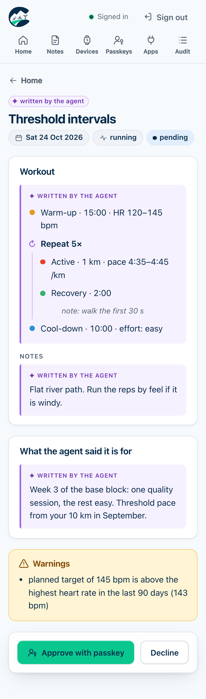
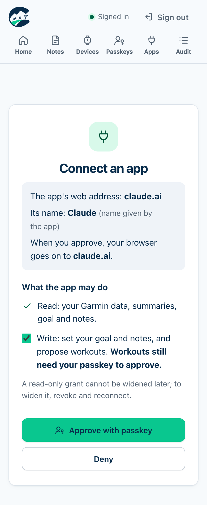
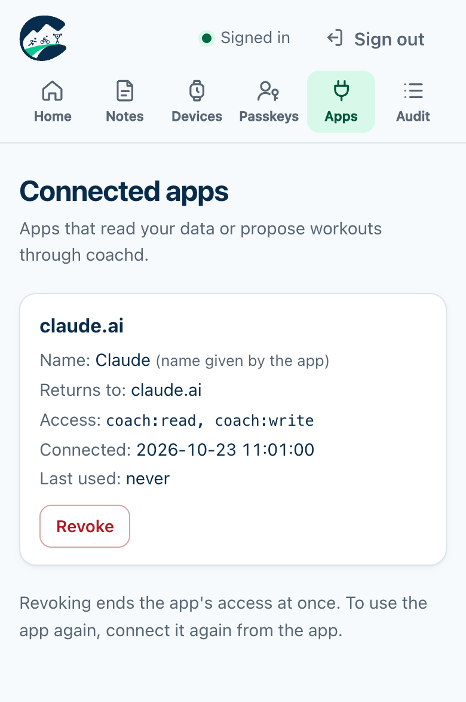

# coachd

> A self-hosted gateway between your AI coach and your Garmin watch. It serves your Garmin data to any AI agent and puts the workout you agreed on onto your watch, but only after you approve it.

Ships as one Docker image that runs anywhere: a Raspberry Pi, a home server or a VPS. One instance serves one runner. Your Garmin key stays on your hardware.

**📖 Documentation: [stefiix92.github.io/coachd](https://stefiix92.github.io/coachd/)**: [install](https://stefiix92.github.io/coachd/docs/install/), [connect an agent](https://stefiix92.github.io/coachd/docs/agents/), [watch app](https://stefiix92.github.io/coachd/docs/watch/), [MCP tools](https://stefiix92.github.io/coachd/docs/agents/tools/).

**Status:** early and built by one runner for their own training, but it works end to end: Garmin data in, MCP out, passkey-approved workouts to the watch. Expect rough edges. While the version is 0.x, a minor release may change configuration or behaviour, so read the [changelog](CHANGELOG.md) before upgrading.

  
  
  

Approving a workout, connecting an app (built-in auth) and the connected apps, on a phone. Fake data from a test instance.

---

## Why

- Talking training through with an AI (reviews, how you feel, weather, niggles) works better than a black-box plan like Garmin's Daily Suggested Workouts.
- A plain AI chat can't see your watch data, forgets context between chats, and can't put a workout on your watch.
- An AI must never push anything to your watch on its own.

coachd is a **gateway, not a coach**: the AI agent and you decide the training; coachd provides the data, keeps the context, warns, and delivers only after your explicit approval.

## What it does

1. **Data in.** Activities with their original FIT files, sleep, HRV, resting HR, Body Battery and more, from the official [Garmin Connect Personal API](https://developer.garmin.com/gc-developer-program/personal/), plus simple totals. Numbers, never verdicts.
2. **Context.** The goal the agent sets and a few durable notes, so any agent or new chat starts informed.
3. **Workout out.** The agent proposes a structured workout; you approve it with a passkey; coachd delivers it through a Connect IQ watch app, as a FIT file, or as a Zwift workout.
4. **Your own rating.** Your post-workout "How did you feel?" and RPE reach the agent too.
5. **Planned vs actual.** The executed steps of each workout, linked to the workout coachd delivered.

There is no chat UI and no built-in LLM. You talk to Claude (or ChatGPT, Gemini, Cursor, Open WebUI or a local model), and the agent calls coachd over **MCP**. No MCP tool can approve, deliver or withdraw a workout: only you can, with your passkey.

Read [how it works](https://stefiix92.github.io/coachd/docs/how-it-works/), then [install it](https://stefiix92.github.io/coachd/docs/install/). You need your own Garmin Connect Personal API key and a Docker host (arm64 or amd64).

## Stack

Go, the official MCP Go SDK, SQLite (pure Go), `muktihari/fit`, `go-webauthn`, and server-rendered HTML with no npm. The watch app is Connect IQ (Monkey C). Packaging is a signed multi-arch image plus `deploy/compose.yaml` with Tailscale, Grafana Alloy, VictoriaMetrics and VictoriaLogs.

Design records are in [`docs/design/`](docs/design/), starting with [`coachd-design.md`](docs/design/coachd-design.md). The documentation site's source is in [`docs/content/`](docs/content/).

## Roadmap

Next: a smoother first-time install, and wider live testing of AI clients against built-in mode. Changes are listed in [`CHANGELOG.md`](CHANGELOG.md).

## Disclaimer

Not affiliated with or endorsed by Garmin. Not medical advice. If something hurts, stop and see a professional.

## Contributing and security

- Contributions are welcome: see [`CONTRIBUTING.md`](CONTRIBUTING.md). Commits need a DCO sign-off.
- Found a vulnerability? Report it privately, as described in [`SECURITY.md`](SECURITY.md). Please don't open a public issue.

## Support

coachd is free and built in spare time. If it helps your training, you can [buy me a coffee on Ko-fi](https://ko-fi.com/stefiix92).

## License

[GNU Affero General Public License v3.0](LICENSE) (AGPL-3.0-only). You may use, modify and self-host coachd freely. If you run a modified version as a service for others, you must publish your changes under the same license.
