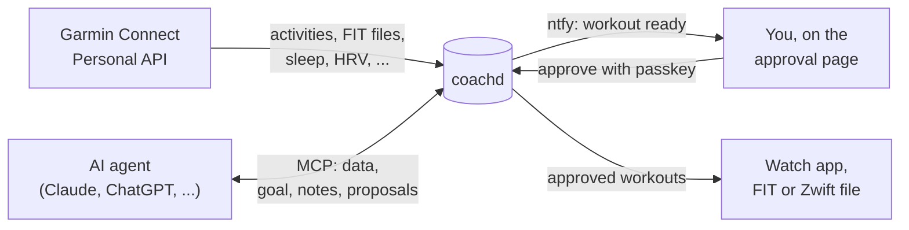

coachd sits between three parties: Garmin, your AI agent and you. It moves data from Garmin to the agent, and workouts from the agent to your watch, and nothing reaches the watch until you approve it.

## Data in

coachd pulls your data from the official [Garmin Connect Personal API](https://developer.garmin.com/gc-developer-program/personal/): activities with their original FIT files, sleep, HRV, resting HR, Body Battery, stress and more. It syncs hourly, backfills two years of history on first start, and honours Garmin's rate limits.

It also computes simple totals at ingest (weekly volume, longest run, HRV against your normal range) so the agent doesn't do arithmetic. These are numbers, never verdicts: coachd never says "ready" or "should".

An activity you delete in Garmin Connect disappears from coachd too, once Garmin confirms it is gone (404). This is a soft delete: the raw JSON and the original FIT file are kept.

Garmin free text (activity names and descriptions) is untrusted: it reaches the agent labelled as such, because anyone who can name an activity could try to instruct the agent through it.

## Context

coachd stores the goal the agent sets (an event, its date, distance and a target) and a few durable notes: injuries, availability, preferences. Any agent, or a new chat, starts informed.

- Agents can edit or delete only notes that agents wrote. Your own notes are read-only to them.
- A note can carry `valid_until`, its last day ("travelling until 6 Nov"). After that, the agent no longer sees it unless it asks for expired notes; the page shows it faded until someone deletes it.

## Workout out

The agent proposes a structured workout with `propose_workout`. coachd checks that it's physically plausible and well-formed, and attaches warnings, such as "longer than 110% of your longest run in the last 30 days". Warnings never block: you and the agent decide.

Then:

1. coachd stores the proposal as `pending` and, if [ntfy](/docs/install/notifications/) is set up, notifies your phone.
2. You read the workout, the warnings and the agent's rationale on coachd's page, and approve with a passkey.
3. coachd delivers it through the [watch app](/docs/watch/), or you download it as a FIT file, or, for cycling, as a [Zwift workout](/docs/workouts/cycling/).

[Approving workouts](/docs/workouts/) has the details.

A proposal is immutable once stored. To change it, the agent proposes a new one that `replaces` it, and the change takes effect only when you approve the new one. Every state change goes to the audit log.


**No agent path to the watch.** No MCP tool and no agent credential can approve, deliver, withdraw or alter an approved workout. Only you can, on coachd's page with your passkey. coachd enforces this itself; it does not rely on the AI app asking you first.


## Your own rating

The "How did you feel?" and RPE answers you give on the watch after an activity reach the agent too, read from the activity's FIT file.

## Planned vs actual

When you run a structured workout on the watch, coachd reads the steps back from the activity's FIT file: per executed step, the time, distance, heart rate, pace and power, and the seconds inside, below and above its heart-rate or pace range.

It links the activity to the workout it delivered, so the agent can review a week of plans against what you did. The link needs the steps the watch recorded to equal the workout coachd delivered, dated within 3 days of it. Garmin Coach and Garmin Connect workouts get the executed steps too, without the link.

## Two ways in

coachd listens on two lanes, each with its own credentials:

| Lane | For | Reached through | Credential |
|---|---|---|---|
| **Public** | claude.ai, ChatGPT, the approval page on your phone, the watch app | a hostname you control: Cloudflare Tunnel or a reverse proxy, on `127.0.0.1:8080` | [Cloudflare Access](/docs/install/cloudflare-access/) or coachd's [built-in auth](/docs/install/builtin-auth/); the watch has its own device token |
| **Private** | Claude Code, Cursor, local models on your own devices | [Tailscale](/docs/install/tailscale/) only (no Funnel) | scoped static tokens |

No port is open to the network: the only published port is the public listener on loopback, for the tunnel or reverse proxy on the same host. See the [security model](/docs/reference/security/).

## What coachd will not do

coachd is a gateway, not a coach. It has no coaching logic, readiness verdicts or blocking training rules, no chat UI and no built-in LLM. It does not upload to Garmin Connect, and it is not for hosting other runners: one instance serves one runner, with their own Garmin key.
