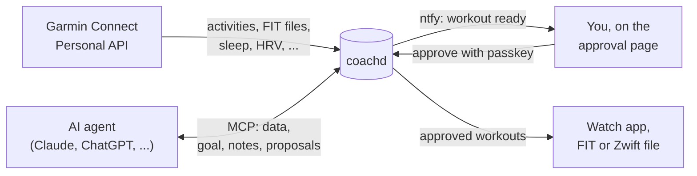

## Data in

coachd syncs your Garmin data hourly from the official [Garmin Connect Personal API](https://developer.garmin.com/gc-developer-program/personal/): activities with their original FIT files, sleep, HRV, resting HR, Body Battery, stress and more. On first start it backfills two years.

At ingest it computes simple totals (weekly volume, longest run, HRV against your normal range), so the agent doesn't do arithmetic. They are numbers only: coachd never says "ready" or "should".

- An activity deleted in Garmin Connect disappears from coachd too, once Garmin confirms it is gone. The raw JSON and FIT file are kept.
- Activity names and descriptions reach the agent labelled untrusted: anyone who can name an activity could try to instruct the agent through it.
- The "How did you feel?" and RPE answers you give on the watch after an activity reach the agent too.

## Context

The agent sets a goal (an event, its date, distance and target) and keeps a few notes: injuries, availability, preferences. Any agent, or a new chat, starts informed. A note can end on a date ("travelling until 6 Nov"). Agents can't edit or delete notes you wrote.

## Workout out

1. The agent proposes a structured workout. coachd checks it is plausible and attaches warnings, such as "longer than 110% of your longest run in the last 30 days". Warnings never block.
2. coachd notifies your phone ([ntfy](/docs/install/notifications/), optional).
3. You read the workout, the warnings and the agent's reasons on coachd's page, and approve with your passkey.
4. The [watch app](/docs/watch/) picks it up, or you download a FIT file, or a [Zwift workout](/docs/workouts/cycling/).

A proposal never changes once stored: the agent replaces it with a new one, which you approve again. Every state change goes to the audit log. See [Approving workouts](/docs/workouts/).


**No agent path to the watch.** No MCP tool and no agent credential can approve, deliver, withdraw or alter an approved workout. coachd enforces this itself, not the AI app.


## Planned vs actual

When you run a structured workout, coachd reads its steps back from the activity's FIT file: per executed step, time, distance, heart rate, pace and power, and the seconds inside, below and above its heart-rate or pace range. It links the activity to the workout it delivered (same steps, within 3 days), so the agent can review a week of plans against what you did. Garmin Coach and Garmin Connect workouts get the executed steps too, without the link.

## Two lanes

| Lane | For | Reached through | Credential |
|---|---|---|---|
| **Public** | claude.ai, ChatGPT, the approval page, the watch app | your hostname, via a tunnel or reverse proxy to `127.0.0.1:8080` | [Cloudflare Access](/docs/install/cloudflare-access/) or [built-in auth](/docs/install/builtin-auth/); a device token for the watch |
| **Private** | Claude Code, Cursor, local models | [Tailscale](/docs/install/tailscale/) only | scoped static tokens |

No other port is published. See the [security model](/docs/reference/security/).
